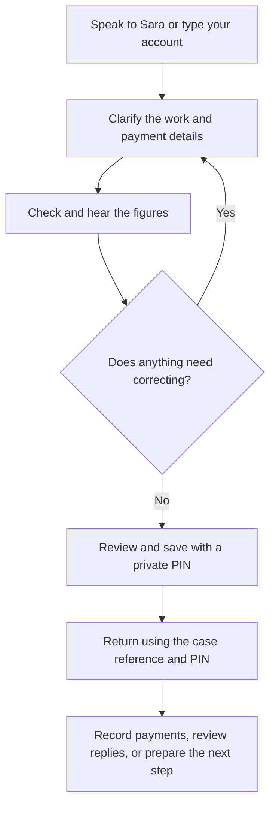
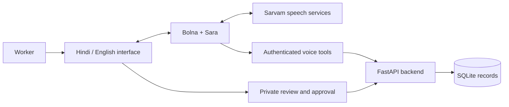

# HaqRecord

### Tell your story. Check your wages. Keep a clear record.

HaqRecord is a voice-first application that helps workers organise an unpaid-wage account, understand the figures, and prepare information they can use when seeking help.

A worker can speak in Hindi or English, explain what happened, check the information captured, and save a private record. They can return later to record a payment, review an employer’s reply, keep track of a promise, or prepare documents for their next conversation with a support organisation or relevant authority.

**HaqRecord helps workers prepare and maintain their account. It does not automatically file a government complaint, independently verify every statement, or guarantee wage recovery.**

---

## Why this project exists

An unpaid-wage problem does not always arrive as a neat set of documents.

A worker may remember the daily rate but not the exact dates. Part of the payment may have arrived in cash. A contractor may describe an earlier advance as a new payment. The agreement may have been verbal, and the available records may be scattered across messages, photographs, and personal recollection.

Turning that experience into a clear account can be difficult, especially when the process involves unfamiliar forms, language barriers, or limited confidence with reading and writing.

HaqRecord focuses on that preparation step:

- Let the worker explain what happened in their own words.
- Ask about the details that still need clarification.
- Separate money received from money promised.
- Calculate from the figures the worker has supplied.
- Keep original statements and supporting material available for review.
- Help the worker return to the same account as the situation changes.

The aim is to make it easier to begin and continue seeking help with an organised record.

## Who it is for

The prototype is designed around workers who may face unpaid or partly paid wages, including construction workers, daily-wage workers, and people working through informal arrangements.

It can also support a conversation between a worker and someone helping them, such as a caseworker or worker-support organisation.

The current interface supports **Hindi and English**. Curated support information currently covers **Hyderabad and Bengaluru**.

These locations identify the prototype’s support-information scope. They do not mean the application has verified every local legal rule or can determine the correct authority from a city name alone.

---

## How it works



### A simple example

A worker explains:

> “I worked for five days. We agreed on ₹1,000 per day. I have received ₹1,000.”

HaqRecord calculates:

| Item | Amount |
|---|---:|
| Reported earnings | ₹5,000 |
| Money received | ₹1,000 |
| Remaining wages | ₹4,000 |

The worker can hear the figures, correct a detail, and review the account before saving.

If the employer later **promises** ₹1,500, the remaining amount stays at ₹4,000.

If the worker later confirms that ₹1,500 **actually arrived for this case**, the remaining amount becomes ₹2,500.

Keeping these events separate is central to the application.

---

## What workers can do

### 1. Explain their account by voice or text

Sara is the application’s conversational voice assistant.

A worker can speak in Hindi or English rather than begin with a long form. Sara collects the relevant details, asks follow-up questions, and uses connected backend tools to prepare information for review.

Typing remains available for people who prefer it or cannot use their microphone.

### 2. Check the wage calculation

The application supports:

- Hourly wages
- Daily wages
- Weekly wages
- Monthly wages
- Payment per piece or unit
- Confirmed work periods with different rates

The backend performs the arithmetic.

Unclear quantities or payments need clarification. A calendar month should not silently become four weeks, and an uncertain receipt should not automatically become either zero or a confirmed payment.

The displayed balance is based on the recorded account. It is not a determination of statutory entitlement.

### 3. Save a private case and return later

Workers save a case using a **case reference and a private PIN**.

They can use those details to reopen the same record later, including when using a shared phone.

The worker’s access flow is separate from the caseworker login.

### 4. Use voice guidance inside individual sections

A general conversation is useful at the beginning. Later, a worker may need help with one particular part of the record.

Each block under **Build Your Case Record** therefore has its own Sara microphone.

| Section | What the voice option does |
|---|---|
| Check the agreement and payments | Guides the worker through the payment basis, quantity, rate, sources, payment entries, and points needing clarification. |
| Add supporting material and link facts | Guides file selection or skipping, description, storage choice, source selection, and the information being linked. |
| Facts and their sources | Explains the displayed facts and source references. |
| Follow up on this case | Guides the reminder and payment-follow-up fields. |
| Case history | Explains the displayed timeline. |

In an editable section, Sara asks one field question at a time and fills an **unsaved draft in that section**.

The worker can:

- **Pause** and keep their answers.
- **Continue** from the retained question.
- **Restart** that section.
- **Finish talking** and review the fields.

Calls use the Hindi or English selected at the start. To begin in another language, pause and start again with that language selected.

The facts/source list and case history are read-only. Their voice options explain existing records rather than create a new questionnaire.

### 5. Add supporting material

Workers can upload or paste material themselves and keep it alongside the case.

Depending on the workflow, supported material includes text, PDFs, photographs, and short supported audio recordings.

The application keeps a distinction between:

- The original material
- Extracted text
- An explanation or interpretation
- What the worker has confirmed

An uploaded message is not automatically treated as authenticated evidence.

File choice happens in the browser. Sara cannot choose a file from the worker’s device merely because the worker mentions it.

### 6. Track promises and actual payments separately

A promise can include an amount, the words used about the date, and an exact date when the worker can confirm it.

A promise does not reduce the balance.

Actual receipts are recorded separately, with review to help avoid counting the same payment twice. A previously recorded payment can also be corrected while retaining the earlier entry in the history.

### 7. Prepare a payment request

Workers can prepare a request using the confirmed account, hear or read it, and approve the exact version before using the available copy, download, or sharing options.

Preparing or copying a request does not mean it has been sent. Opening a sharing option does not establish delivery or reading.

An optional recipient-response link is also implemented. It requires a suitable public application deployment and exposes only the approved request information. A recipient’s response does not automatically change the wage ledger.

### 8. Set an in-app reminder

Workers can save a reminder for a later follow-up.

**Reminders appear when the worker opens the case.** The current implementation does not send reminder calls, SMS messages, emails, or background notifications.

### 9. Keep a work diary

A worker can maintain a private work diary without first creating an unpaid-wage dispute.

Entries can record the work date, workplace, agreed rate, quantity, and money received.

Diary entries stay separate from a dispute’s balance until the worker explicitly chooses how to include or link them. Linking work that is already counted should not add its earnings a second time.

### 10. Prepare information for seeking help

The application can organise the account into downloadable records and preparation materials.

These can help a worker discuss their situation with a caseworker, support organisation, or relevant office.

Preparation features include factual summaries, payment history, supporting originals, checklists, and fields for recording the worker’s report of an external submission or acknowledgement.

**Preparing a document is not the same as submitting a complaint. An acknowledgement uploaded by a worker is not independently verified government status.**

---

## Sara and the AI components

HaqRecord uses one main conversational assistant, **Sara**, with different modes and connected tools. The individual section microphones are focused modes of the same assistant, rather than separate autonomous agents.

| Component | Role |
|---|---|
| **Sara — general conversation** | Collects the worker’s account, clarifies details, explains tool results, and prepares changes for review. |
| **Sara — section guidance** | Helps with the selected case-record block and follows its field-by-field question plan. |
| **Section guidance controller** | Application logic that decides the current field, validates answers, and prevents a section call from using general case tools. This is not a separate language model. |
| **Optional source interpretation** | Uses separately configured services to extract or explain supported uploaded material. Results still need review. |
| **Optional resource research** | Uses Exa to find relevant source links when configured. Search results do not establish legal applicability. |

### Configured voice stack

The configured prototype uses:

| Layer | Technology |
|---|---|
| Voice-call orchestration | **Bolna** |
| Browser voice connection | **Bolna Web Call SDK** |
| Conversation model | **GPT-4.1 mini through Azure**, configured in Bolna |
| Speech recognition | **Sarvam Saaras v4** |
| Speech generation | **Sarvam Bulbul v3** |
| Configured voice | **Simran** |

Provider and model settings can be changed in the deployment. API access, credits, service availability, microphone permission, and connectivity affect live calls.

Implementation and iterative debugging were assisted by **OpenAI Codex**. Codex is a development tool here, not a worker-facing runtime agent.

---

## What AI handles—and what the application controls

Sara helps with conversation and collecting answers. The application controls calculations, access, validation, and saving.



Important boundaries include:

- Voice tools are tied to the current call and, where applicable, the worker’s opened case.
- A section call can fill only its selected section’s draft.
- Voice does not submit the section’s form.
- PINs and final approval stay on the website.
- The backend calculates balances.
- Promises and unclear payments remain distinct from confirmed receipts.
- Uploaded text is treated as material to review, not as instructions for the assistant.

These boundaries reduce reliance on the model following a prompt perfectly.

---

## Tech stack

| Area | Technologies |
|---|---|
| Backend | Python, FastAPI, Uvicorn |
| Interface | HTML, CSS, JavaScript |
| Data storage | SQLite |
| Data validation | Pydantic |
| Authentication | Private sessions, case reference/PIN access, Argon2id hashing through `pwdlib` |
| Voice | Bolna Web Call SDK and authenticated callbacks |
| Speech | Sarvam recognition and speech generation |
| Conversation model | Configured through Bolna; the prototype uses Azure GPT-4.1 mini |
| HTTP integrations | HTTPX |
| PDF text extraction | pypdf |
| Image handling | Pillow |
| Optional source processing | Sarvam APIs |
| Optional web research | Exa |
| Browser checks | Playwright with Chromium/Chrome |
| Additional checks | Python test scripts and Node.js checks |

The interface uses plain browser technologies; it does not require a separate frontend build step to run.

---

## Run it locally

### What you need

- Python 3.12, the version used during development
- A modern browser
- Git to clone the repository
- Internet access and configured provider accounts for live voice or optional external services

Node.js is useful for the JavaScript checks, but it is not required to serve the application.

### 1. Clone the project

```bash
git clone https://github.com/quratulain-nayeem/HaqRecord.git
cd HaqRecord
```

### 2. Create a Python environment

The following commands use Windows PowerShell:

```powershell
py -3.12 -m venv .venv-native
.\.venv-native\Scripts\python.exe -m pip install -r requirements.txt
```

### 3. Choose how to try it

#### Option A: Explore the isolated fictional demo

```powershell
.\.venv-native\Scripts\python.exe run_resolution_demo.py
```

Open:

```text
http://127.0.0.1:8002/
```

The terminal prints a fictional case reference and PIN.

This mode uses separate demo storage and includes sample material for exploring the case workflow.

**Live voice, direct external processing, and recipient-link activation are deliberately disabled in this isolated demo.** It demonstrates the application workflow, not a live speech session.

To reset the fictional demo, stop its server first, then run:

```powershell
.\.venv-native\Scripts\python.exe run_resolution_demo.py --reset
```

#### Option B: Run the main application

Copy the environment template:

```powershell
Copy-Item .env.example .env
```

For local HTTP development, set this in `.env`:

```dotenv
SESSION_COOKIE_SECURE=false
```

Use secure cookies when deploying with HTTPS.

Start the application:

```powershell
.\.venv-native\Scripts\python.exe -m uvicorn main:app --host 127.0.0.1 --port 8000 --reload --no-access-log
```

Open:

```text
http://127.0.0.1:8000/
```

Text-based workflows can be explored without connecting every optional service. Live voice requires the additional setup below.

### Optional caseworker account

To create the local caseworker account:

```powershell
.\.venv-native\Scripts\python.exe setup_account.py
```

The script asks for a username and password privately.

The caseworker login is at:

```text
http://127.0.0.1:8000/login
```

Workers returning to their own case use the worker interface with their case reference and PIN.

---

## Connecting live voice

Live voice requires a configured Bolna agent, speech services, and a reachable callback bridge.

The main environment settings are:

| Setting | Purpose |
|---|---|
| `BOLNA_API_KEY` | Server-side access to Bolna |
| `BOLNA_AGENT_ID` | The configured Sara agent |
| `HAQRECORD_VOICE_TOOL_SECRET` | Authenticates calls from the voice provider to the application’s tools |
| `HAQRECORD_VOICE_PUBLIC_URL` | Public HTTPS address of the callback bridge |
| `HAQRECORD_SERVICE_API_KEY` | Separate service credential used by protected backend integrations |

Keep these credentials in the local environment configuration. Do not put them in browser code or commit them.

Run the callback bridge separately:

```powershell
.\.venv-native\Scripts\python.exe -m uvicorn bridge_app:app --host 127.0.0.1 --port 8001 --reload --no-access-log
```

Bolna needs a public HTTPS address that reaches this bridge. The callback bridge is separate from the full worker website.

The repository includes Windows startup helpers for the local app, bridge, and temporary tunnel. They require the expected Python environment and a separately installed Cloudflare tunnel executable. They are not a complete production deployment.

Voice-registration scripts can update the remote agent. Review their output and configuration before applying changes. The registration and repair scripts should not be treated as an automatic first-run installer.

For the section-specific workflow, see [SECTION_VOICE_GUIDANCE.md](SECTION_VOICE_GUIDANCE.md).

---

## Optional integrations

The application shows configuration or availability limits when an optional service is not connected.

| Setting | Enables |
|---|---|
| `SARVAM_API_KEY` | Direct processing of supported uploaded images/audio and configured source explanations |
| `HAQRECORD_REPLY_MODEL` | Selects the configured model used for source interpretation |
| `EXA_API_KEY` | Optional fresh research for relevant source links |
| `HAQRECORD_PUBLIC_APP_URL` | Public application address needed for usable recipient-response links |

Bolna’s speech-provider configuration does not automatically provide a direct Sarvam API key for uploaded-document processing.

Local UTF-8 text and text-bearing PDF extraction are available without assuming unrestricted AI document understanding.

Current file limits include:

- Files up to **5 MB**
- PDFs up to **20 pages**
- Supported PCM WAV recordings up to **29 seconds**

Full scanned-PDF OCR and direct access to a worker’s WhatsApp account are not implemented.

---

## Privacy and control

The project is designed to keep the worker involved in checking and approving their record.

Implemented controls include:

- Hashed PINs and passwords
- Private, expiring browser sessions
- Case-bound voice access
- Request checks that help prevent another site from submitting actions through the worker’s session
- Explicit review before saving
- Protection against accidental repeated payment operations
- Preservation of original statements and correction history
- Deletion of the active private record and its associated originals

These controls do not mean every layer of a deployment is automatically secure.

SQLite data is **not claimed to be encrypted at rest**. Live conversations involve external providers, and their processing and retention depend on the configured services and account settings.

Workers should never speak their PIN, bank password, or OTP to Sara.

Deleting a record from the active application does not automatically delete previously downloaded copies, operator backups, or provider-retained data.

---

## Testing

The repository includes checks for:

- Wage calculations and unclear quantities
- Payments, promises, corrections, and duplicate handling
- Case access and private approvals
- Supporting-material workflows
- Diary entries and allocation
- Voice callback authentication
- Section-specific question plans and scope restrictions
- Pause, resume, and restart
- Hindi/English interface changes
- Mobile layout and browser interactions

Install the development dependencies:

```powershell
.\.venv-native\Scripts\python.exe -m pip install -r requirements-dev.txt
```

Example backend checks:

```powershell
.\.venv-native\Scripts\python.exe tests/test_worker_voice.py
.\.venv-native\Scripts\python.exe tests/test_resolution.py
.\.venv-native\Scripts\python.exe tests/test_section_voice.py
```

Example JavaScript check:

```powershell
node tests/test_voice_review.js
```

Browser workflow check:

```powershell
.\.venv-native\Scripts\python.exe tests/test_resolution_browser.py
```

The browser test currently expects Chrome at its standard Windows installation path.

Tests use fictional records and temporary databases. Provider mocks and SDK doubles check application behavior without starting real calls.

**Passing these checks does not establish live transcription accuracy, audio quality, or usability with actual workers. Those require separate real-world evaluation.**

---

## Current limitations

HaqRecord is a working prototype with boundaries:

- The interface currently supports Hindi and English.
- Curated support information currently covers Hyderabad and Bengaluru.
- The application does not determine legal jurisdiction or statutory entitlement.
- It does not automatically submit complaints or synchronise government case status.
- Reminders are in-app, rather than externally delivered notifications.
- Uploaded material is not independently authenticated.
- Some source-processing features need separately configured services.
- Live voice depends on provider access, credits, connectivity, and microphone permission.
- The project has not established field-tested outcomes or wage-recovery success rates.

The downloadable output is an organised account and supporting record. It should not be presented as automatically verified evidence, an official certificate, or a guaranteed legally sufficient filing.

---

## Project guide

| File or folder | What it contains |
|---|---|
| `main.py` | Main application |
| `worker.py` and `auth.py` | Worker access, sessions, and authentication |
| `case_models.py` and `case_service.py` | Case data and calculation logic |
| `database.py` | Persistent case and payment records |
| `voice_backend.py` | Voice sessions, callbacks, and browser approvals |
| `section_voice.py` | Field-by-field plans for individual case sections |
| `voice_agent_guard.py` | Checks required voice connections and configuration |
| `case_workspace.py` | Evidence, corrections, reminders, and downloadable packets |
| `resolution.py` and related modules | Replies, promises, requests, diary, and follow-up workflows |
| `bridge_app.py` | Restricted voice callback server |
| `web/` | Worker interface and browser code |
| `tests/` | Automated checks |
| `demo_fixtures/` | Clearly fictional demonstration material |

Additional reading:

- [Demonstration walkthrough](DEMO_SCRIPT.md)
- [Section voice guidance](SECTION_VOICE_GUIDANCE.md)
- [Local startup notes](LOCAL_STARTUP.md)
- [Resolution workflow details](RESOLUTION_HANDOVER.md)
- [Evaluation template](EVALUATION_TEMPLATE.md)

Some supporting documents describe earlier development stages. Check the current code and configuration when following setup instructions.

## What comes next

Useful next steps include:

- Testing the interface with workers and support organisations
- Measuring whether workers can complete key tasks with less assistance
- Evaluating transcription, corrections, interruptions, and language consistency
- Expanding languages and carefully maintained support information
- Improving deployment, monitoring, and recovery from interrupted processing
- Assessing accessible ways to deliver reminders beyond the application
- Reviewing legal-routing information with qualified local partners

The most useful measure of progress is whether a worker can leave with a clearer, more accurate account they understand and can continue using.

## License

See [LICENSE](LICENSE) for the repository’s license terms.
